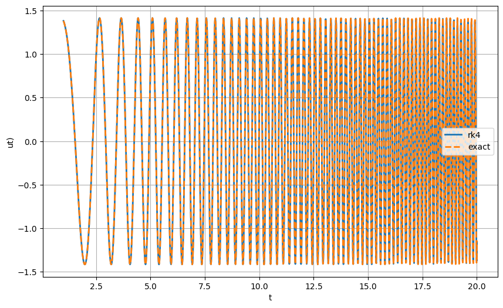

# Numerical ODE Solver Using Fourth-Order Runge–Kutta (RK4)

## 1. Project Overview

This project implements a numerical method for solving an ordinary differential equation (ODE) using the **Fourth-Order Runge–Kutta (RK4) method** in Python.

The numerical solution is obtained by discretizing the independent variable and iteratively calculating the solution at successive time steps.

## 2. Numerical Method

The fourth-order Runge–Kutta method is an explicit numerical integration technique that estimates the solution of an initial-value problem using four intermediate slope evaluations at each step.

For an equation of the form

\[
\frac{dy}{dt}=f(t,y)
\]

the numerical update is calculated as:

\[
y_{n+1}=y_n+\frac{h}{6}(k_1+2k_2+2k_3+k_4)
\]

where \(h\) is the step size and the intermediate slopes are evaluated using the RK4 scheme.

## 3. Implementation

The Python implementation includes:

- Definition of the differential equation.
- Initialization of the independent variable and initial conditions.
- Implementation of the RK4 integration algorithm.
- Iterative calculation of the numerical solution.
- Storage of the computed results for subsequent analysis.

## 4. Results

The output of the numerical solver is provided in the following image.

## 5. Files

| File | Description |
|---|---|
| `Numerical-ODE-Solver-RK4.py` | Python source code implementing the RK4 method. |
| `Numerical-ODE-Solver-RK4.png` | Screenshot of the code output and numerical results. |

## 6. Technologies

- **Programming Language:** Python
- **Library:** NumPy
- **Application:** Google Colab

## 7. Learning Outcomes

- Understanding numerical methods for solving ordinary differential equations.
- Implementing the fourth-order Runge–Kutta algorithm.
- Applying numerical integration to an initial-value problem.
- Using Python and NumPy for scientific computing.

---

*This project demonstrates the implementation of a classical numerical integration method for solving ordinary differential equations.*
